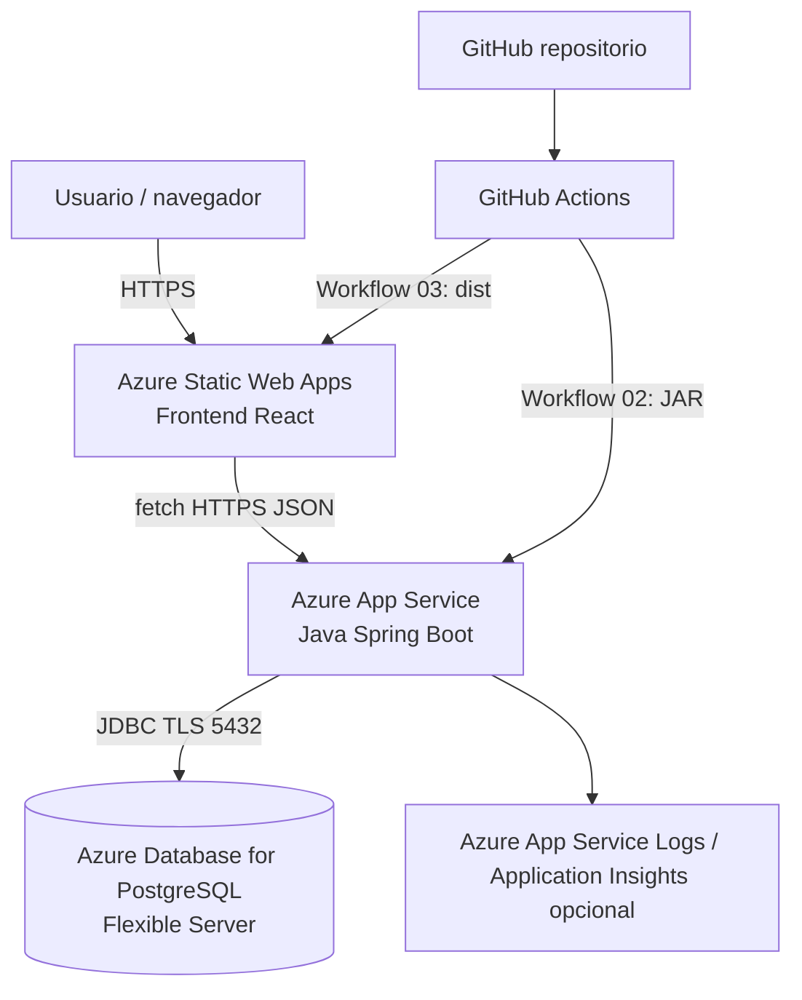
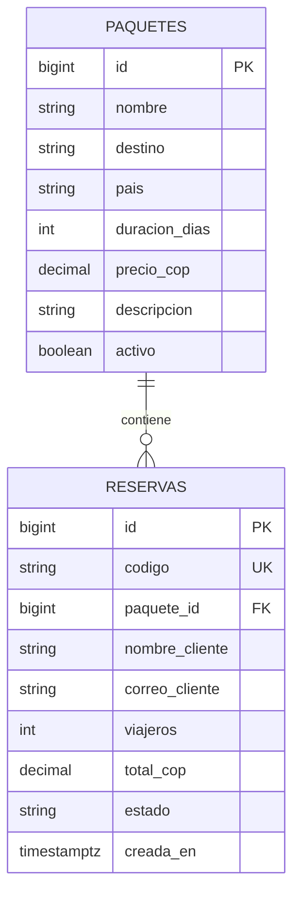

# Arquitectura: ¿cómo se prepara una aplicación para Azure?

## Diagrama lógico

**Importante**: frontend y backend **NO** comparten servidor. Static Web Apps sirve HTML/CSS/JS estático; App Service ejecuta el JAR Java. El navegador llama HTTPS al App Service. Solo el backend conoce las credenciales de PostgreSQL.

## Mapeo archivo → servicio Azure

| Archivos del repositorio | Función | Servicio en Azure |
|---|---|---|
| `frontend/src/App.jsx`, `styles.css` | Pantallas, búsqueda, formulario reserva | **Static Web Apps** |
| `frontend/.env.example` | URL pública de API (`VITE_API_URL`) | **GitHub Actions build-time** |
| `backend/src/.../controller` | Rutas REST `/api/v1/*` | **App Service (Java 21)** |
| `backend/src/.../service` | Reglas para crear reservas | **App Service** |
| `backend/src/.../repository` | Acceso a BD con JPA | **App Service** |
| `backend/src/main/resources/application.yml` | Puerto, PostgreSQL, CORS | **App Service → Variables de entorno** |
| `backend/src/main/resources/db/migration/*` | Crear tablas/datos con Flyway | **PostgreSQL Flexible Server** |
| `.github/workflows/01-validacion.yml` | Compilación y pruebas | **GitHub Actions** |
| `.github/workflows/02-desplegar-backend.yml` | Publica el JAR | **GitHub Actions → App Service** |
| `.github/workflows/03-desplegar-frontend.yml` | Publica `dist/` | **GitHub Actions → Static Web Apps** |

## Flujo de una reserva real en el ejercicio

1. El navegador abre `https://SU-FRONTEND.azurestaticapps.net`.
2. React consulta `GET https://SU-BACKEND.azurewebsites.net/api/v1/paquetes`.
3. Spring Boot consulta PostgreSQL mediante JPA.
4. Se ven seis paquetes de ejemplo.
5. Al pulsar **Reservar**, React envía `POST /api/v1/reservas` con nombre, correo, viajeros e ID de paquete.
6. Spring valida el DTO, busca el precio en el servidor, calcula el total y guarda la fila en PostgreSQL.
7. La API devuelve HTTP 201, código `RES-XXXXXXXX`, estado `PENDIENTE` y total; la interfaz lo muestra.
8. **No se cobra nada**, no hay login ni pago real ni disponibilidad garantizada: es un MVP docente.

## Por qué esta organización evita errores

- **URLs desacopladas**: `VITE_API_URL` se configura al construir React. El frontend no contiene `localhost` fijo de producción.
- **Credenciales fuera de Git**: `DB_URL`, `DB_USER`, `DB_PASSWORD` viven en Azure App Service → Variables de entorno. No poner credenciales en GitHub ni en JavaScript.
- **Red**: CORS_ALLOWED_ORIGINS debe contener el dominio exacto del frontend (`https://...azurestaticapps.net`), sin `/` final. CORS no reemplaza la autenticación ni las reglas firewall.
- **Datos versionados**: Flyway ejecuta `V1` y `V2` una sola vez; JPA usa `ddl-auto: validate`, evitando regenerar tablas.
- **Tests antes de deploy**: CI verifica backend y frontend; el despliegue se dispara manualmente al principio.
- **Salud y diagnósticos**: `GET /actuator/health` permite comprobar el arranque y la base de datos; si falla mirar App Service → Log stream.

## Modelo entidad-relación

### Próximas pantallas para convertirlo en un sistema comercial

Login, administración de paquetes, catálogo de hoteles/vuelos, inventario real, calendarios, pagos, facturación, CRM, reportes, gestión de usuarios/roles, auditoría y multiempresa. **Estas no están implementadas en el MVP.**
